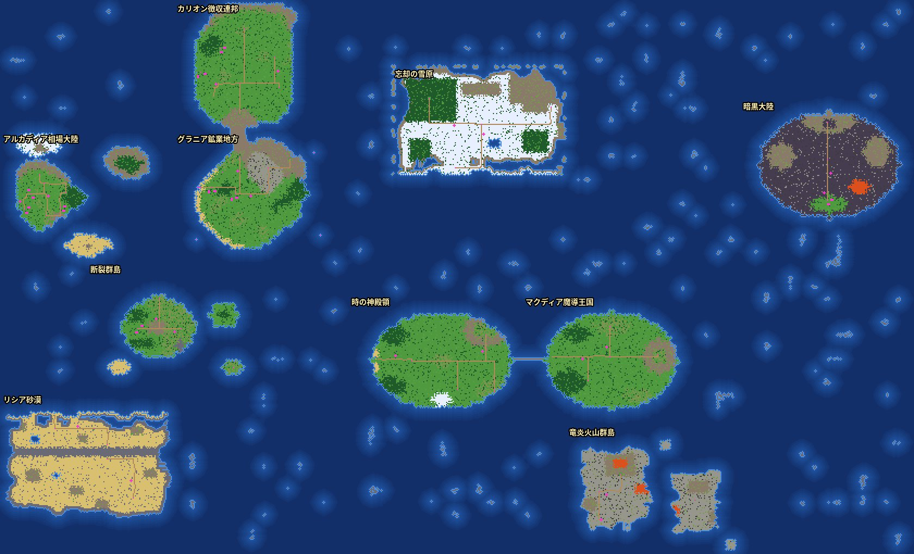

# シームレスな世界（3D 版）：設計・配置・進入条件・セーブ

依頼：2026-11-05 19:26「TradeQuest_Seamless_World_Claude_Prompt.txt」（地上の地域フィールドと海を、連続して移動できる 3D ワールドに）。
全マップの対応表（自動生成）は `WORLD76_MAPS.md`。確かめた結果は `REPORT.md` の 14 章。

## 0. 作業の記録
- 指示ファイルの対象ブランチは `feature/3d-full`。開始時（2026-11-05 19:30 ごろ）の `dev/feature/3d-full` の HEAD は `62900a3`（`git fetch` で確認）。
- 作業は `feature/env-overhaul` で続けた。このブランチは `62900a3` を含み（`git merge-base --is-ancestor` で確認）、そのあとに環境リデザインと前回の「世界のつなぎ込み」の 68 コミットがある。開始時の HEAD は `778b501`、未コミットの変更は `REPORT.md` の追記と `docs/tools/v76/join76_air.js`（このあと一緒にコミット）。`3d-full` は書き換えていない。
- プロジェクト内の指示ファイル（CLAUDE.md など）はない。本番（`prod/main`）には触れていない。
- 切り替え：3D設定「世界のつながり」（つなぐ／地域ごと。`localStorage 'mtq3d-join'`）。「地域ごと」にすると前の方式（航路の端で場面が切り替わる）に戻る。2D 版はいつも前の方式。

## 1. 地上の世界と別の空間
| 分類 | 地図 | 移動 |
|---|---|---|
| 地上の世界（つなぐ） | 10 地域（アルカディア相場大陸 world・グラニア鉱業地方・カリオン徴収連邦・忘却の雪原・暗黒大陸・断裂群島・時の神殿領・マクディア魔導王国・リシア砂漠・竜炎火山群島）＋共通の海 23 枚（sea76_*） | 境目は画面を切り替えずに移動（徒歩・船・飛空艇） |
| 地上の世界の中の町・ダンジョン・建物の中 | 町 24・ダンジョン 100・建物の中 389（WORLD76_MAPS.md） | 前のまま場面の切り替え（依頼の範囲外。入口・出口の座標は変えていない） |
| 別の空間（空の上） | 天空群島（world_sky）と、その中の町・ダンジョン | 飛空艇で「世界の北の果て」から上へ。降りるとアルカディアの北へ。天空群島から「闇の空路」で暗黒大陸へ（前のまま） |
| 別の空間（異空間） | ゼロメア（world_machine）と、その中の町・ダンジョン | 時の神殿領の転移門（前のまま）。設定上、宇宙に浮かぶ異空間なので地上とはつながない |
| 物語の場面 | 序章の村（アサナ村の襲撃の夜など）16 | 前のまま |

天空群島は「空の上」、ゼロメアは「異空間（宇宙）」という設定のため、別のレイヤーのままにした。地上の地方はすべて同じ世界に入れた（地上の地域で別レイヤーに逃がしたものはない）。

## 2. 世界の配置（世界の座標）

- 世界は 840×510 マス。40×30 マスの「ブロック」（21×17）に区切る。
- 地域（160×120＝4×4 ブロック）を、格子に並べず、ずらして置いた。決め方：もとの航路の向き（「東の遠洋航路」なら東どなり）と、灰の峠の南口（グラニア 60,24）と北口（カリオン 60,104）が南北にそろうこと。

| 地域 | 左上（世界の座標） | もとの航路・道とのつながり |
|---|---|---|
| カリオン徴収連邦 | 160, 0 | グラニアの北（灰の峠の北口が南端。峠のまわりの海は山脈） |
| アルカディア相場大陸 | 0, 120 | 東にグラニア（小型帆船の海）・南に断裂群島 |
| グラニア鉱業地方 | 160, 120 | 西にアルカディア・北にカリオン |
| 忘却の雪原 | 360, 60 | 時の神殿領の北（間に海） |
| 暗黒大陸 | 680, 90 | 北東の離れた大陸（飛空艇だけ） |
| 断裂群島 | 80, 240 | アルカディアの南・時の神殿領の西・リシア砂漠の北 |
| 時の神殿領 | 320, 270 | 東にマクディア魔導王国（陸の橋） |
| マクディア魔導王国 | 480, 270 | 南に竜炎火山群島 |
| リシア砂漠 | 0, 360 | 断裂群島の南 |
| 竜炎火山群島 | 520, 390 | 魔導王国の南 |

- 地域のないブロックは共通の海（最大 4×4 ブロックの長方形にまとめた 23 枚の地図）。地形は世界の座標から決まる：陸から 1 マス以内＝浅瀬、5 マス以内＝海、それより沖＝深い海（遠洋航海船）。沖に小さな岩礁（崖。上陸できない）。名前は近い地域の「〇〇の沖」（遠ければ「外海」）。陸の敵は出ない（船の上は乗り物の出現表）。
- 世界の外縁：外へは進めない（「この先は荒れ狂う外洋の嵐」）。3D は世界の果てに嵐の壁。北の果てだけは飛空艇で天空群島へ上がれる（もとの「北の空路」）。東西・南北のループはない。

## 3. 座標の決まり
- 世界の座標（gx, gy）：1 マス＝地域の地図の 1 マス（回転・伸縮なし）。`gx = 地図の左上の gx + ローカル x`、`gy = 地図の左上の gy + ローカル y`（`World76.toGlobal` / `toLocal`）。
- タイルの中心は +0.5（3D の位置）。地図の右端・下端の外（x = 幅、y = 高さ）は、となりの地図の 0 列目。境目のマスは 1 つの地図にだけ属する（`World76.mapAt`）。
- 正とするもの：ゲームの状態（セーブ・宝箱・出来事・出現表・乗り物）は今までどおり「地図の ID＋ローカル座標」。世界の座標は、境目の移動・3D の並べ方・地図・案内でその場で計算するだけ（別に保存しないので、二つが食い違うことはない）。
- 出現表・出来事・毎歩の処理は、ローカル座標のまま（境目を越えると、その地図のローカル座標になる）。地図 ID・町 ID・出来事 ID・宝箱 ID・クエスト ID は変えていない。

## 4. 進入の条件（`World76.entryBlock` 1 か所で判定）
| 地域 | 条件（フラグ） | 立つところ | 乗り物 | 見え方 |
|---|---|---|---|---|
| カリオン徴収連邦 | kalion_open | 灰の峠の関所（js/data/grania.js の gate・needFlag verum_liberated） | 徒歩（峠）・遠洋航海船・飛空艇 | 3D：霧の壁。地図：暗く「（まだ行けない）」 |
| 断裂群島 | galleon_ready | 港町マリナの船大工（js/data/islands.js） | 遠洋航海船・飛空艇 | 同上 |
| 時の神殿領・リシア砂漠・忘却の雪原 | yorn_letter_done | 灰灯島アルナのヨルン（js/data/islands.js） | 同上 | 同上 |
| マクディア魔導王国 | zeromea_choice_done | オラクル中枢の選択（js/data/tempus.js） | 徒歩（陸の橋）・遠洋航海船・飛空艇 | 同上 |
| 竜炎火山群島 | magicka_arrived | 魔導都の入口の魔導騎士（js/data/magicka.js） | 遠洋航海船・飛空艇 | 同上 |
| 暗黒大陸 | dark_route_open | 天空群島の制御室（js/data/sky.js） | 飛空艇だけ（船は黒い嵐で止まる） | 同上 |
| （乗り物） | 小型帆船 ship_ready（js/data/towns.js）・遠洋航海船 galleon_ready・飛空艇 airship_owned（js/data/magicka.js） | | 小型帆船はアルカディアとグラニアの海だけ（もとの航路と同じ） | |

- 新しいフラグは作っていない。条件はもとの航路（`js/data/vehicles.js` の needFlag）・関所・乗り物と同じ。忘却の雪原は、もとは時の神殿領からしか行けなかったので神殿領と同じ条件。
- 境目の移動（徒歩・帆船・遠洋航海船・飛空艇）・地図の表示・3D の霧の壁が同じ判定を使う。理由の表示は同じ文を 4 秒に 1 回まで。
- 海流・嵐（`Vehicle.drift`）は同じ地図の中だけで船を動かす（境目は越えない）。
- 到着先の確かめ：ワープ・イベントの移動など（`World.enterMap` の raw でない呼び出し）で、ほかの地域の地図から、まだ行けない地域へ着こうとしたら、最後に泊まった宿へ（ふつうの進行では起きない。起きたら `World76.blockedArrivals` を数える）。その地域の町・ダンジョンから出るとき・セーブの読み込み（raw）はそのまま。ファストトラベル・宿へ戻るは町へ着くので対象外。
- 意図して変えたこと：カリオンは、関所を通ったあとは船・飛空艇でも入れる（前は峠の道だけ）。時の神殿領⇔魔導王国は陸の橋を歩いても行ける（条件は前の航路と同じ zeromea_choice_done）。

## 5. 地形の手直し（つないだときだけ。2D 版の地形は変えない）
- 海岸の形：リシア砂漠・忘却の雪原（崖・山で囲まれた四角）と竜炎火山群島（四角い島）を、ゆらぎのある海岸線と丸い角に（世界の座標のノイズ）。
  町・入口・道・宝箱・人・出来事のまわりは触らない。砂漠・雪原は新しい岸から 2 マスを崖・山にして、新しい上陸地点を作らない（砂嵐の回廊などを船で回りこめない）。もとの砂浜（上陸できた岸）は削らない。
  手直しのあと、入口・宝箱などどうしのつながりが 2D 版と同じことを確かめる（違えば浅くしてやり直し、だめなら手直しなし）。
- 灰の峠の山並み：グラニアの峠の南口とカリオンの北口の間の海を山脈（通れない）に。峠はダンジョンのまま。
- 陸の橋：時の神殿領 ⇔ マクディア魔導王国（26 マス）。船は橋の下をくぐれる。前回あった魔導王国 ⇔ 暗黒大陸の橋は外した（暗黒大陸は飛空艇だけ）。
- 水の深さの色は、陸からの距離（世界の座標）で決める（地域の地図と共通の海の境目で色が切れない）。タイルの種類（浅瀬・海・深い海）は乗り物と敵の出方にだけ使う。

## 6. 3D の描画・先読み
- 地図（地域・共通の海）が描画の単位（チャンク）。主人公の世界の座標から 48 マス以内に入る地図を先に組み立て（1 枚ずつ）、72 マスより遠い地図は外す。並べるのは近い順に 8 枚まで。
- 組み立てでゲームの状態は変えない（訪問済み・出来事・宝箱は、その地図に入ったときだけ）。
- 組み立ては 24ms 以上続けて動いたら 1 フレーム画面へ返す。映す前にシェーダーと画像を用意（compileAsync・initTexture）。古い組み立てが遅れて終わっても、いまの地図の 3D を上書きしない（同じ地図を2つ作らない・`buildingMap` で照合）。
- 境目を越えても、主人公・カメラ・仲間の追従・乗り物・歩きのアニメーション・歩数・戦闘の猶予・状態異常は初期化しない（位置をずらすだけ）。
- 地図の外の海・木・山（OUT の余白）は、世界の果ての側だけ作る。

## 7. 乗り物・港
- 乗り物の位置・停泊先・乗船状態は「地図の ID＋ローカル座標」（共通の海の地図も含む）。境目を越えると乗り物ごと移る（`Vehicle.syncToPlayer`）。
- 上陸は同じ地図の中だけ（境目をまたいで降りない）。共通の海には上陸できる陸がない（岩礁は崖）。
- 桟橋・呼び寄せ・全滅のとき港へ戻す・船を置いたまま町へ入る、は前のまま（vehicle.js・harbors.js は変えていない。案内の出口だけ、道の範囲 `seg` の中から選ぶ）。

## 8. 地図・ミニマップ・案内
- 地域の地図「つながった世界（全体）」：実際の配置と同じデータで 1 枚に。訪れていない地域の名前は「？？？」、まだ行けない地域は暗く。町・ダンジョンは訪れたものだけ。
- ミニマップ：端に近づくと、まわりの地図（地域・共通の海）も描く。
- 世界（絵の地図）：地域の絵を実際の配置（世界の座標 × 2.4）に置き直した。天空群島・ゼロメアは下の帯に「別の空間」として置く。訪れていない地域は「？？？」（つないだときだけ）。
- 次の目的地の案内：となりどうしの地図の道（150 本）で計画する。まだ行けない地域・持っていない乗り物の道は使わない。天空群島へは北の果ての地図から。

## 9. セーブ
- 形は変えていない（`pos.map` ＋ ローカル座標、乗り物も同じ）。移行（座標の変換）はいらないので、二重の変換も起きない。前の版のセーブはそのまま読める。
- 共通の海（sea76_*）にいるセーブを「地域ごと」の 3D 版・2D 版で読むと、いちばん近い地域の端へ移す（乗り物ごと。`World76.normalizeSave`。動かしたら `w76moved` に記録）。もう一度読んでも動かさない。
- 前回の版の外海（sea76_south・sea76_east）にいるセーブは、その版の並びで近い地域の端へ。
- 3D 版は `mtq-3d-slot-*`、2D 版は `mtq-rpg-v2-slot-*`（分けたまま。3D 版は 2D 版のセーブを書き換えない）。JSON の取り込み・クラウドの読み込みも `World.start` を通るので同じ処理。
- 新しい版のセーブを前の実装で読む場合：共通の海にいなければそのまま続けられる。共通の海にいるセーブは、前の実装ではその地図がないため「最後に泊まった宿」へ移る（`World.fixLostMap`）。完全な互換ではない。

## 10. 確かめ方
- `node docs/tools/v76/world76_check.js`（jsdom）：配置・座標の往復・地形の手直し（つながり・新しい上陸地点）・境目の移動（全手段・両方向・遠洋の長い航海を 1 歩ずつ）・全地域全境目の進入条件・物語の段階ごとに行ける地域・天空群島への入口・セーブ。
- `docs/tools/v76/join76_*.js`（3D・ヘッドレス Chromium）：境目の移動と画面・霧の壁・地図・セーブ・組み立て前に越えたとき・飛空艇・初めて映るフレームの重さ。
- `node docs/tools/v76/world76_table.js`：全マップの対応表（WORLD76_MAPS.md）を作り直す。
